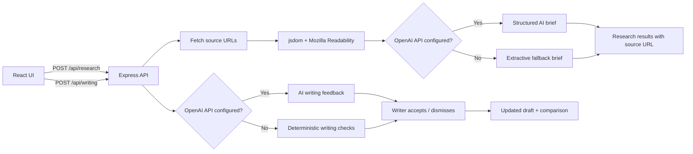

# AI Editorial Workspace

**Editorial Desk** is a lightweight research-to-draft workspace for newsletter editors. It helps an editor move from several source URLs to a structured research brief, then improve a draft while keeping control of every edit.

> **Project status:** Working local prototype. Public deployment and end-to-end verification must be completed by the project owner before submission. The app supports AI-assisted analysis when an OpenAI API key is configured and deterministic fallback checks when it is not.

## 1. Problem and primary user

**Primary user:** An editor producing an AI/technology newsletter for founders, builders, and business operators.

**Problem selected:** Editors spend time collecting and reading sources, but the harder work is deciding what matters, distinguishing source-backed statements from interpretation, and explaining the implications clearly. This prototype focuses on that research-to-writing handoff rather than building a complete publishing platform.

## 2. Core workflow

1. Add at least three unique article or announcement URLs (up to eight).
2. The Express API retrieves each page and uses Mozilla Readability to extract its main text.
3. Each accessible source is summarized into a structured brief.
4. The editor reviews what happened, why it matters, who should care, source statements, analysis, caveats, and a possible newsletter angle.
5. The editor starts a draft and moves to the Writing Assistant.
6. The Writing Assistant flags writing issues and offers suggestions.
7. The writer accepts or dismisses each suggestion and can compare the original with the current draft.

## 3. Features

### Research Assistant
- Accepts 3–8 unique HTTP(S) URLs.
- Extracts readable article text.
- Produces concise structured briefs.
- Highlights what happened, why it matters, and who should care.
- Separates source statements from editorial interpretation.
- Retains the original source URL beside each brief.
- Suggests a potential newsletter angle.
- Handles each source independently, so one inaccessible URL does not stop the others.

### Writing Assistant
- Checks for long sentences, filler phrases, possible passive voice, and selected technical terms.
- Shows the passage, reason, and suggested improvement.
- Lets the writer accept or dismiss suggestions individually.
- Keeps the original draft unchanged until an edit is accepted.
- Shows an original/current comparison.
- Displays word count, estimated reading time, sentence count, and average sentence length.

Metrics are diagnostic signals, not a definitive score of writing quality. Technical language should remain when it is necessary and meaningful to the audience.

## 4. Product decisions and trade-offs

**Prioritized**
- The smallest useful end-to-end workflow: sources → brief → draft → editorial feedback.
- Source links visible in the research result.
- Explicit separation of source statements and analysis.
- Writer control over every suggested change.
- Deterministic fallback behavior so the core UI can be explored without an API key.

**Deliberately not built**
- Publishing and newsletter distribution.
- User accounts, teams, comments, and collaboration.
- Scheduled monitoring and social-platform integrations.
- A full web search engine.
- A claim-level citation verifier or independent fact-checking engine.

These were left out to keep the prototype focused on the assignment's highest-value workflow within the 6–8 hour constraint.

**How usefulness could be measured**
- Median time from source collection to a usable editorial brief.
- Editor-rated usefulness of the suggested story angle.
- Percentage of writing suggestions accepted versus dismissed.
- Blind editor ratings of clarity, accuracy, and preservation of author intent.
- Number of factual corrections required after editing.

## 5. Architecture



### Technology stack
- **Frontend:** React 18, Vite, Lucide React
- **Backend:** Node.js, Express
- **Article extraction:** jsdom and `@mozilla/readability`
- **AI integration:** OpenAI API (optional)
- **Fallback analysis:** JavaScript rules

## 6. AI versus deterministic logic

| Capability | Implementation |
|---|---|
| Article text extraction | Deterministic page retrieval and Readability parsing |
| AI research brief | OpenAI model when `OPENAI_API_KEY` is configured |
| No-key research fallback | Extractive summary plus clearly labelled generic editorial prompts |
| AI writing feedback | OpenAI model when configured |
| No-key writing feedback | Rules for long sentences, filler, possible passive voice, and selected jargon |
| Word count / sentence count / average length / reading time | Deterministic calculations |
| Accept / dismiss / compare | Frontend state and string replacement |

The no-key research fallback is **not** an independent fact-check and should not be presented as one. The AI output can also omit nuance or misinterpret a source. An editor must verify important claims against the original source.

## 7. Reliability, source support, and limitations

- The API accepts only HTTP(S) URLs, removes duplicates, requires at least three unique URLs, and limits a request to eight sources.
- Each source is processed independently. HTTP errors, timeouts, blocked pages, and insufficient extracted text are surfaced as per-source errors.
- AI responses are requested in JSON format and parsed before being returned to the UI.
- Each brief retains the URL from which its text was extracted.
- **Current limitation:** the prototype does not yet align every generated claim to an exact quoted passage or independently corroborate claims across sources. A source link establishes provenance, not proof that every sentence in the brief is supported.
- Some websites block automated access, require authentication, or render content only in a browser. Such sources may fail extraction.
- The deterministic passive-voice and jargon checks are heuristics and can produce false positives.
- The current draft builder is a starting point; editors should review and expand it into a coherent article rather than treating it as publish-ready copy.

## 8. Sample editorial output

The companion file [`SAMPLE_EDITORIAL.md`](./SAMPLE_EDITORIAL.md) contains a 300–500-word newsletter-style example based on three linked reports, plus a before-and-after editing example. The figures are attributed to the organizations that conducted the respective surveys; their samples and methodologies differ, so the figures should not be treated as directly comparable.

## 9. Before-and-after example

The companion sample includes:
- Original draft paragraph.
- Writing Assistant feedback examples.
- Revised paragraph.
- Explanation of which edits are safe and which require author judgment.

The tool should not automatically change figures, names, quotations, technical claims, uncertainty, causal language, or the author's central argument. It should not remove necessary technical terms merely to make a readability metric look better.

## 10. Setup and local run

**Requirements:** Node.js 18+ and npm.

```bash
git clone https://github.com/Karthik214005/AI-Editorial-Workspace.git
cd AI-Editorial-Workspace
npm install
```

Create a `.env` file in the project root by copying `.env.example`.

```env
OPENAI_API_KEY=
OPENAI_MODEL=gpt-4o-mini
PORT=8787
```

`OPENAI_API_KEY` is optional. Without it, the app uses deterministic fallback behavior.

Start the development servers:

```bash
npm run dev
```

Open `http://localhost:5173`.

Build and run the production server locally:

```bash
npm run build
npm start
```

The Express server serves the built frontend from `dist` and listens on port `8787` by default.

## 11. Environment variables

| Variable | Required? | Purpose |
|---|---|---|
| `OPENAI_API_KEY` | No | Enables AI research briefs and AI writing feedback |
| `OPENAI_MODEL` | No | Model name; defaults to `gpt-4o-mini` |
| `PORT` | No | Express port; defaults to `8787` |

Never commit `.env`, API keys, or other secrets. `.env.example` is safe to commit.

## 12. Testing checklist

Before presenting the project, run and verify these checks locally:

- [ ] `npm install` completes successfully.
- [ ] `npm run dev` starts both the API and Vite frontend.
- [ ] Research accepts three unique accessible URLs and rejects fewer than three.
- [ ] At least one inaccessible URL displays an error without blocking successful sources.
- [ ] Research briefs show original source links and distinguish source statements from analysis.
- [ ] Writing Assistant detects several issue types on a test draft.
- [ ] Accept changes the draft; dismiss leaves the draft unchanged.
- [ ] Original/current comparison displays the two versions.
- [ ] No `.env` file or API secret is committed.
- [ ] Production build succeeds with `npm run build`.

Only mark a test as completed after personally running it.

## 13. Tools and implementation disclosure

This project was developed with assistance from ChatGPT. The generated project includes the React interface, Express endpoints, URL extraction, optional OpenAI integration, deterministic fallback checks, editing controls, metrics, and documentation. The project owner should disclose which parts they personally changed, tested, and verified. Do not claim tests or deployment were completed unless they were actually performed.

## 14. Future improvements

With another day of work, the highest-value improvements would be:
1. Store exact source passages for each factual claim and show claim-level citations.
2. Compare sources and flag agreement, disagreement, and unsupported claims.
3. Support pasted article text and PDF extraction when URL retrieval fails.
4. Add undo and a robust word-level diff for accepted edits.
5. Evaluate suggestion precision with a small editor-reviewed test set.

## 15. Submission links

- **Live application:** Add the deployed public URL here after deployment. Do not submit `localhost`.
- **GitHub repository:** https://github.com/Karthik214005/AI-Editorial-Workspace
- **README:** This file.

